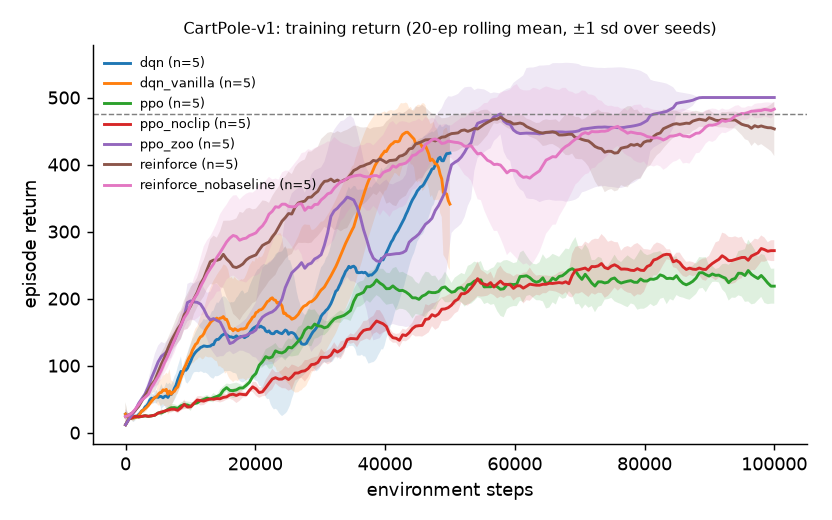
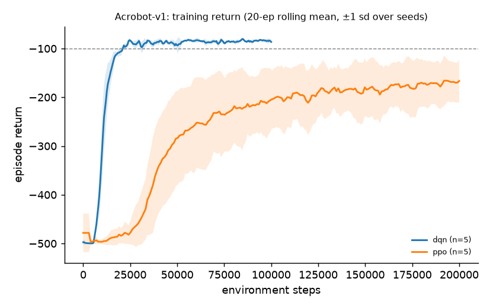

# rl-from-scratch

[](https://github.com/kishorhange111/rl-from-scratch/actions/workflows/ci.yml)

Readable, unit-tested implementations of core deep RL algorithms in PyTorch — **DQN**
(Double / Dueling / Polyak), **PPO** (clip, GAE, vectorized envs) and **REINFORCE** —
with a multi-seed benchmark CLI and analysis that reports **sample efficiency**, not just
final scores.

Every number below was produced by the code in this repo on a laptop CPU (Intel Core,
1 thread per run), 5 seeds per configuration, greedy evaluation on held-out env seeds.

## What's implemented

| Module | Contents |
|---|---|
| [`buffers.py`](src/rlfs/buffers.py) | GAE (Schulman et al. 2016) over `[T, N]` rollouts with correct terminal masking; circular replay buffer; on-policy rollout buffer |
| [`dqn.py`](src/rlfs/dqn.py) | DQN with Double-DQN targets (van Hasselt 2016), dueling head (Wang 2016), Polyak target updates, Huber loss, ε-schedule; time-limit truncation does **not** cut the bootstrap |
| [`ppo.py`](src/rlfs/ppo.py) | PPO-clip following *The 37 Implementation Details of PPO*: vectorized envs, truncation bootstrap from `V(final_obs)`, per-minibatch advantage norm, clipped value loss, entropy bonus, LR annealing, target-KL early stop; logs approx-KL, clip fraction, explained variance |
| [`reinforce.py`](src/rlfs/reinforce.py) | REINFORCE with optional learned baseline — the variance reference point |
| [`cli.py`](src/rlfs/cli.py) | `rlfs --algo ppo --env CartPole-v1 --seeds 0 1 2 3 4 --set key=value` → JSON with full learning curves, mean ± sd and **IQM** across seeds (Agarwal et al. 2021) |
| [`benchmarks/analyze.py`](benchmarks/analyze.py) | Steps-to-solve, training AUC, learning-curve plots |

Tests cover the math, not just shapes: GAE against a hand-computed trajectory and the λ=1
Monte-Carlo identity, Double vs vanilla targets on a constructed case where they disagree,
PPO clipping zeroing the gradient only on the pessimistic side, clipped value loss, plus
learning smoke tests (DQN and PPO must beat a random policy within a small budget in CI).

## Results



| env | method | budget | greedy eval (mean ± sd) | IQM | train AUC | median steps to solve | seeds solved |
|---|---|---|---|---|---|---|---|
| CartPole-v1 | PPO, RL-Zoo hyperparameters | 100k | **500.0 ± 0.0** | 500.0 | 341.7 | **51.6k** | **5/5** |
| CartPole-v1 | PPO, CleanRL Atari-style defaults | 100k | 442.1 ± 40.9 | 439.7 | 175.6 | — | 0/5 |
| CartPole-v1 | PPO defaults, clipping disabled | 100k | 482.9 ± 17.3 | 485.0 | 166.4 | — | 0/5 |
| CartPole-v1 | REINFORCE + baseline | 100k | 483.3 ± 21.3 | 490.1 | **372.1** | 56.7k | 4/5 |
| CartPole-v1 | REINFORCE, no baseline | 100k | 500.0 ± 0.0 | 500.0 | 365.6 | 55.2k | 5/5 |
| CartPole-v1 | Double DQN | 50k | 456.6 ± 97.0 | 500.0 | 184.1 | — | 1/5 |
| CartPole-v1 | vanilla DQN | 50k | 388.2 ± 153.2 | 409.7 | 225.3 | 45.1k | 3/5 |
| Acrobot-v1 | Double DQN | 100k | **-75.8 ± 5.4** | -76.2 | -132.8 | **20.8k** | **5/5** |
| Acrobot-v1 | PPO, defaults | 200k | -109.8 ± 54.9 | -87.8 | -259.9 | — | 0/5 |

"Solved" = 20-episode rolling *training* return ≥ 475 (CartPole) / ≥ -100 (Acrobot).
Full per-seed JSON, including every episode, is in [`benchmarks/results/`](benchmarks/results).
Reproduce a row: `rlfs --algo ppo --env CartPole-v1 --steps 100000 --seeds 0 1 2 3 4 --tag zoo --set n_steps=32 gamma=0.98 lam=0.8 epochs=20 minibatches=1 ent_coef=0.0 lr=0.001`.

### What the numbers say (and don't)

- **Hyperparameters dominate algorithm choice at this scale.** The same PPO code goes from
  0/5 to 5/5 seeds solved by switching from CleanRL's Atari-oriented defaults
  (`n_steps=128 × 8 envs`, 4 epochs, lr 2.5e-4) to the published RL-Baselines3-Zoo CartPole
  settings (`n_steps=32`, 20 epochs, γ=0.98, λ=0.8, lr 1e-3). No per-seed tuning was done.
- **Final greedy return saturates on CartPole** (cap 500), so it cannot separate methods —
  e.g. REINFORCE without a baseline "wins" on final score. Training AUC and steps-to-solve
  are the more informative columns; that is why the analysis script exists.
- **The ablations are inconclusive on CartPole.** Disabling PPO clipping or the REINFORCE
  baseline did not hurt at 5 seeds; the seed spread (shaded bands) is larger than the
  effect. I report this rather than tuning until the "expected" ordering appears. A harder
  task (e.g. LunarLander or MinAtar) is the right place to test those ablations.
- **Double DQN** had the better final greedy policy (IQM 500 vs 410) but its *training*
  return lagged vanilla DQN at 50k steps; with ε-greedy exploration still at 5%, training
  return understates the greedy policy for both.
- **Acrobot:** Double DQN solved all 5 seeds in a median 20.8k steps; PPO with defaults
  did not reach -100 on training returns within 200k steps (greedy eval −110 ± 55).



## Quickstart

```bash
pip install -e ".[dev]"
pytest -q                                         # math + learning tests
rlfs --algo dqn --env CartPole-v1 --steps 50000 --seeds 0 1 2
python benchmarks/analyze.py benchmarks/results --plots docs/img
```

## References

Mnih et al. 2015 (DQN) · van Hasselt et al. 2016 (Double DQN) · Wang et al. 2016 (Dueling) ·
Schulman et al. 2016 (GAE), 2017 (PPO) · Huang et al. 2022 (*37 Implementation Details of
PPO*) · Agarwal et al. 2021 (*Deep RL at the Edge of the Statistical Precipice*) ·
Raffin et al. (RL Baselines3 Zoo hyperparameters)
